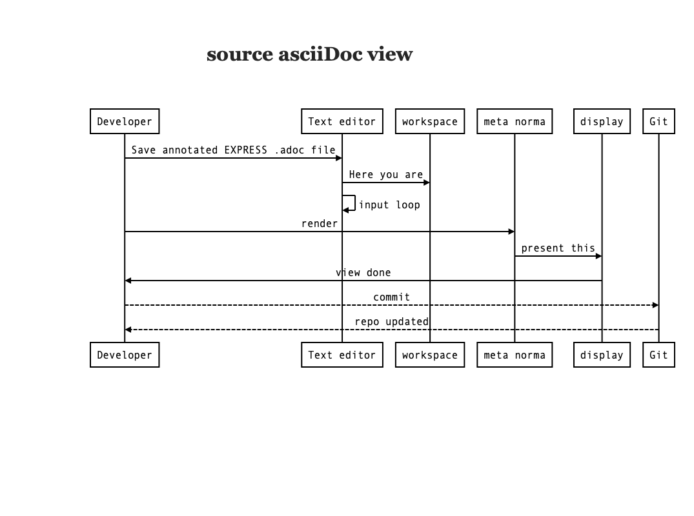
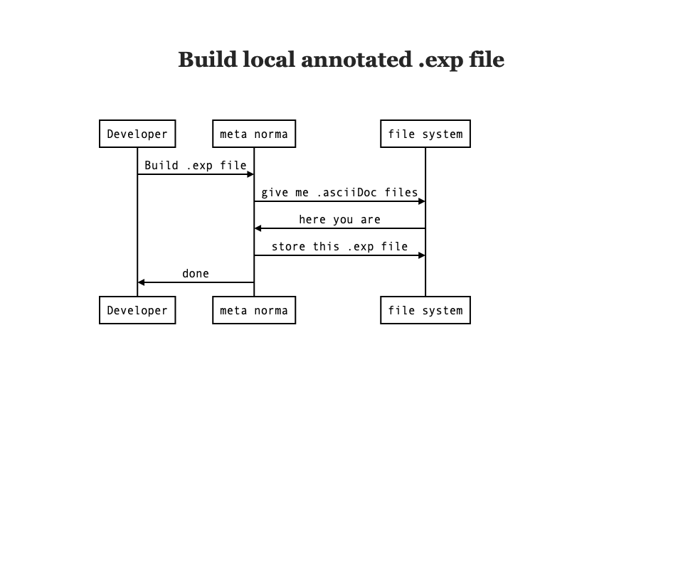

= Annotated EXPRESS

== Design Requirements
Significantly reduce barrier to new developers working in EXPRESS lexical form in STEPmod.
Retain current publication workflow based on XML.
Retain current EXPRESS development workflow based on EXPRESS tooling.

== System Characteristics
=== General
* Single source data.
* Smaller amounts of text per file.
* Easy to use EXPRESS cross-references.
* Support for IPs.
* Git hosted.
* Injection into workflow

=== Single source data
The annotated EXPRESS asciiDoc file (e.g., entity.action.adoc) will be the single lexical source for both the EXPRESS and the associated descriptions.
This file is managed in the Git repo.
The annotated EXPRESS syntax is a superset of Metanorma format.
The superset syntax is based on the usage of the `(* ... *)` remark syntax with `remark tag` (7.1.6.3 of ISO 10303-11) for additional annotations.
A processor will accumulate individual EXPRESS asciiDoc files into the SCHEMA (e.g., action_schema.exp) .exp file.
The SCHEMA .exp file is a valid EXPRESS file.
A processor will generate the relevant xml files (e.g., the arm.xml and arm_descriptions.xml) from this source data.
A further processor will generate the published target HTML files.
A further processor will remove the annotation from the .exp files for public access.

===  Smaller amounts of text per file.
This prototype introduces a modified structure for the EXPRESS source such that each file is appropriately sized for editing.
Each annotated EXPRESS file is named with an EXPRESS declaration type and name (e.g., reference_from.basic_attribute_schema).

=== Schema graph structure
The graph structure mirrors the delivered EXPRESS .exp file.
It is a tree with one root node and one or more leaf nodes.
There are no intermediate nodes in the tree.

=== Schema file extension
Because the snippet files are not valid EXPRESS, we will use the .adoc file name extension.

=== Root files
The `root file` for the document will contain an attribute declaring the document encoding to be metanorma.
The encoding applies to all schemata associated with the document, in addition to the main body of the document.

The `root file` for schemata contains the SCHEMA level contents plus includes for the leaf files. 

NOTE: The exact encoding protocol for the workflow process is an outcome of the prototype.

==== Root file for resource document
The file `stepmod/data/resource_docs/<doc_name>/resource.adoc` will be the `root` .adoc file for the resource document.

EXAMPLE: The `root file` for the part 41 resource document is stepmod/data/resource_docs/fundamentals_of_product_description_and_support.adoc
 
==== Root file for resource schema
The location for the `root file` is: `stepmod/data/resource/<schema_name>/<schema_name>.adoc` 
The `root file` contains the SCHEMA level contents plus includes for the leaf files. There are no intermediate nodes in the tree.

EXAMPLE: The `root file` for the action_schema is stepmod/data/resources/action_schema.adoc.

==== Root file for module document
The file `stepmod/data/modules/<doc_name>/module.adoc` will be the `root` .adoc file for the module document.
 
==== Root file for ARM/MIM shortform schema
The location for the `root file is: `stepmod/data/modules/<doc_name>/<arm|mim>.adoc` 
The `root file` contains the SCHEMA level contents plus includes for the leaf files. There are no intermediate nodes in the tree.

NOTE: There is no .adoc file for EXPRESS longform schemata.

==== Leaf schema file
Each `leaf file` contains annotated EXPRESS for one EXPRESS declaration in the schema.

=== Informal Propositions
The proposal includes support for IPs natively included in the asciiDoc file.

=== Easy to use EXPRESS cross-references.
The `express_ref:[schema.name]` syntax is used to refer to a link to the EXPRESS declaration of `schema.name`.  
The cross references make use of pre-compiled xml indices for speed as needed.

NOTE: Exact syntax Needs more work...

NOTE: Which tool converts the short-hand link to that in descriptions.xml is undetermined at this time but is part of the prototype.

NOTE: Because metanorma is a command line tool and not a text editor, an external application is needed to provide look up for the user to populate the short-hand cross-refs.

=== Git hosting
Yes

=== Injection into workflow
This tooling operates on the very front-end of the development toolchain so no impact on publication environment is envisioned from this
addition.
Use of EXPRESS-G authoring tools based on the cumulative EXPRESS schema file will continue.

== Prototype
=== General
The prototype was created by hand converting an action_schema descriptions.xml file to METANORMA asciiDoc.
Each EXPRESS declaration was partitioned into an individual asciiDoc file.
One for the SCHEMA.
One for each of the other declarations.
The fle names reflect the types and names of EXPRESS declarations to make the file names self-reading. 

WARNING: This is a prototype from the developer view point. 
Actual long-term concrete syntax will be determined upon further discussion and requirements gathered from prototype implementation. 

NOTE: Clutter avoidance in the <schema_name> directory warrants putting the individual EXPRESS files in a subdirectory. 
We may or may not get to this in the prototype.

=== Conceptual prototype workflow viewing
In this example a developer generates viewable results of an edit.

=== Prototype workflow checking EXPRESS 
In this example a developer generates a local .exp file for further processing by Express Engine.

=== Random workflow
This figure shows lots of options for processing. METANORMA is embedded in the syntax checker, and in the automaton, or it might be embedded in the Text editor. It is up to the developer how they prefer to use the technology. There are lots of tools that render the various output forms METANORMA generates. The example is naive but not the focus of the prototype.

image::figure_01.png[Sample workflow]

The "`root`" is the `action_schema.adoc` file.
When the root has been processed, the result will be an annotated `action_schema.exp`.

=== Prototype root file description 
There are two sections to the "`root`" schema file.

The first section describes metadata and information of the `action_schema` SCHEMA
extracted from Part 41 (`resource_docs/fundamentals_of_product_description_and_support/resource.xml`)
under its corresponding `<schema>` tag.
The text in this section is written in the Metanorma format.

Following is an example of the first section.
[source]
----
(*"action_schema"

@version = '8'
@number = '10230'
@number.supersedes = '8369'
@remark.tag.encoding = 'metanorma'
== General
The subject of the *action_schema* is the description of actions, the reasons for these actions, and the status of these actions.
...

image::action_schemaexpg2.xml[]

*)
SCHEMA action_schema '{iso standard 10303 part(41) version(8) object(1) action_schema(1)}';
----

The second section consist of "`import`" statements that include external Annotated EXPRESS files.
For example, `(* reference_from.basic_attribute_schema *)` refers to the file `reference_from.basic_attribute_schema.exp`.
The ordering of the statements dictate the order in the resulting cumulative file.
Following is an example of the second section.

[source]
----
...
  include::reference_from.basic_attribute_schema

  include::reference_from.support_resource_schema

  include::type.as_description_attribute_select
END_SCHEMA;
...
----

=== Prototype EXPRESS declaration files

Each EXPRESS declaration file consists of the EXPRESS declaration of the content of one of the
 `REFERENCE_FROM`, `USE_FROM`, `CONSTANT`, `TYPE`, `ENTITY`, `RULE`, `FUNCTION`, `SUBTYPE_CONSTRAINT`, and `PROCEDURE`
declarations to be combined into the cumulative schema.
The annotation portions are wrapped in the annotated remark tag syntax.

In the following example, the ENTITY `action` declaration is being annotated with this block of rich text.
The `action` declaration is contained in the entity.action.adoc file.

[source]
----
ENTITY action;
  name : label;
...
END_ENTITY;

(*"action"

An *action* is the identification of the occurrence of an activity and a description of its result.

An action has a definition that is specified by an
express_ref:[action_schema.action_method].

NOTE: In particular application domains, terms such as task, process, activity, operation, and event may be synonyms for *action*.

[example]
====
Change, distilling, design, a process to drill a hole, and a task such as training someone are examples of actions.
====

*)
----

Additional annotation remarks can be expressed for attributes and
local rules, see the EXPRESS LRM for specifics. As noted above, although not illustrated herein, an extension to support IPs is required.

[source]

----
(*"action.name"
the express_ref:[support_resource_schema.label]
by which the *action* is known.
*)
----

[source]
----
(*"action_directive_relationship.wr:WR1"
A *action_directive_relationship* shall not participate in its own definition.
*)
----

NOTE: running metanorma on command line for the asciiDoc README.adoc file itself
metanorma --type generic -x html README.adoc
