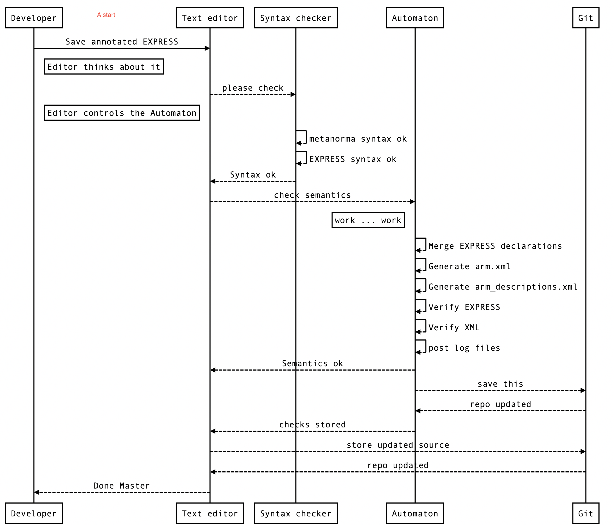

= Annotated EXPRESS
== Design intent
=== Single source data
The annotated EXPRESS will be the single lexical source for both the EXPRESS and the associated descriptions.
The annotated EXPRESS syntax is a superset of Metanorma format.
The superset syntax is based on the usage of the `(* ... *)` remark syntax with `remark tag` (7.1.6.3 of ISO 10303-11) for additional annotations.
A processor will generate the relevant xml files (e.g., the arm.xml and arm_descriptions.xml) from this source data.
A processor will cumulate individual EXPRESS files into the SCHEMA file.

=== Appropriately sized files
When descriptions are combined with the EXPRESS, the files can become large. This prototype introduces
a modified structure for the EXPRESS source such that each file is appropriately sized for editing.
Each file is named with an EXPRESS declaration type and name (e.g., reference_from.basic_attribute_schema).
The content of each file is the content for that declaration with annotation.
=== Informal Propositions
The proposal includes support for IPs.

=== express_ref
The `express_ref:[schema.name]` syntax is used inside annotated remarks to refer to a link to the EXPRESS declaration of `schema.name`.  
The `express_ref:[schema.name]` syntax may be used outside of a SCHEMA as well.

WARNING: This is just a prototype from the developer view point. Actual long-term concrete syntax will be determined upon further discussion and requirements gathered from prototype implementation. The organization structure is chosen for clarity rather than compactness. It is understood that a USE FROM may contain only one line. `Interface` is not included in the initial prototype because it is not an EXPRESS keyword, and thus not in the actual EXPRESS files. It will be considered if the code prototype uses the <schema>.xml as the actual source.

=== Prototype workflow
Here is an example

== EXPRESS root file
=== Structure description 
The "`root`" is the `action_schema.exp` file.

There are two sections to the "`root`" schema file.

The first section describes metadata and information of the `action_schema` SCHEMA
extracted from Part 41 (`resource_docs/fundamentals_of_product_description_and_support/resource.xml`)
under its corresponding `<schema>` tag.
The text in this section is written in the Metanorma format.
The `express_ref:[schema.name]` syntax may be used in this section.

[example] Following is an example of the first section.
[source]
----
(*"action_schema"

@version = '8'
@number = '10230'
@number.supersedes = '8369'

== General

The subject of the *action_schema* is the description of actions, the reasons for these actions, and the status of these actions.
...

image::action_schemaexpg2.xml[]

*)
----

The second section are "`import`" statements that include external Annotated EXPRESS files.
[example] Following is an example of the second section.

[source]
----
...
  (* reference_from.basic_attribute_schema *)

  (* reference_from.support_resource_schema *)

  (* type.as_description_attribute_select *)
...
----

For example, `(* reference_from.basic_attribute_schema *)` refers to the file `reference_from.basic_attribute_schema.exp`.

When all the files are concatenated in the `action_schema.exp`, the result will be the original `action_schema.exp`.
The order of the files in the cumulative schema reflects the ordering in the "`root`" schema file.

== EXPRESS declaration files

Each EXPRESS declaration file consists of the EXPRESS declaration of the content of one of the
 `REFERENCE_FROM`, `USE_FROM`, `CONSTANT`, `TYPE`, `ENTITY`, `RULE`, `FUNCTION`, `SUBTYPE_CONSTRAINT`, and `PROCEDURE`
declarations to be combined into the cumulative schema.
The annotation portions are wrapped in the annotated remark tag syntax.

[example] In the following example, the ENTITY declaration is being annotated with this block of rich text.

[source]
----
ENTITY action;
  name : label;
...
END_ENTITY;

(*"action"

An *action* is the identification of the occurrence of an activity and a description of its result.

An action has a definition that is specified by an
express_ref:[action_schema.action_method].

NOTE: In particular application domains, terms such as task, process, activity, operation, and event may be synonyms for *action*.

[example]
====
Change, distilling, design, a process to drill a hole, and a task such as training someone are examples of actions.
====

*)
----

Additional annotation remarks can be expressed for attributes and
local rules, see the EXPRESS LRM for specifics.

[source]
----
(*"action.name"
the express_ref:[support_resource_schema.label]
by which the *action* is known.
*)
----

[source]
----
(*"action_directive_relationship.wr:WR1"
A *action_directive_relationship* shall not participate in its own definition.
*)
----

