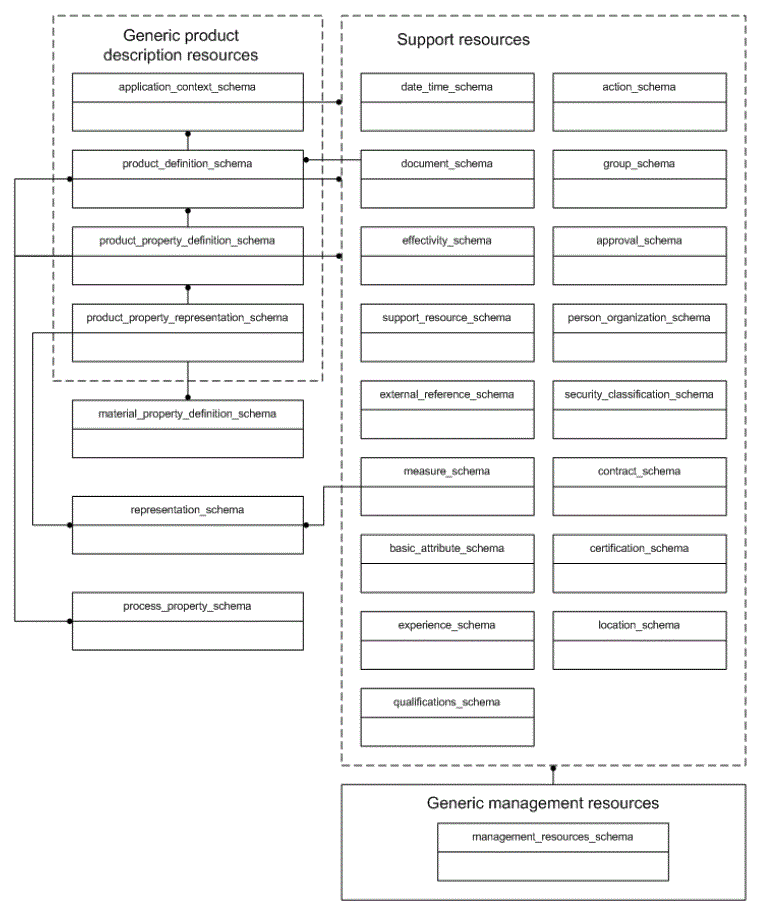

== Introduction

ISO 10303 is an International Standard for the computer-interpretable representation of product information and for the exchange of product data. The objective is to provide a neutral mechanism capable of describing products throughout their life cycle. This mechanism is suitable not only for neutral file exchange, but also as a basis for implementing and sharing product databases, and as a basis for retention and archiving.

Major subdivisions of this part of ISO 10303 are:

// TODO: We want to append ';' to every schema id except
// the last one which should have a full stop.
[lutaml, ../../../resources/action_schema/action_schema_annotated.exp;../../../resources/application_context_schema/application_context_schema_annotated.exp;../../../resources/approval_schema/approval_schema_annotated.exp;../../../resources/basic_attribute_schema/basic_attribute_schema_annotated.exp;../../../resources/certification_schema/certification_schema_annotated.exp;../../../resources/contract_schema/contract_schema_annotated.exp;../../../resources/date_time_schema/date_time_schema_annotated.exp;../../../resources/document_schema/document_schema_annotated.exp;../../../resources/effectivity_schema/effectivity_schema_annotated.exp;../../../resources/experience_schema/experience_schema_annotated.exp;../../../resources/external_reference_schema/external_reference_schema_annotated.exp;../../../resources/group_schema/group_schema_annotated.exp;../../../resources/language_schema/language_schema_annotated.exp;../../../resources/location_schema/location_schema_annotated.exp;../../../resources/management_resources_schema/management_resources_schema_annotated.exp;../../../resources/measure_schema/measure_schema_annotated.exp;../../../resources/person_organization_schema/person_organization_schema_annotated.exp;../../../resources/process_property_schema/process_property_schema_annotated.exp;../../../resources/product_definition_schema/product_definition_schema_annotated.exp;../../../resources/product_property_definition_schema/product_property_definition_schema_annotated.exp;../../../resources/product_property_representation_schema/product_property_representation_schema_annotated.exp;../../../resources/qualifications_schema/qualifications_schema_annotated.exp;../../../resources/security_classification_schema/security_classification_schema_annotated.exp;../../../resources/support_resource_schema/support_resource_schema_annotated.exp, schema, leveloffset=+1]
---
* {{ schema.id }}
---

// From resource.xml/purpose

The generic product description resources provide an overall organization for the integrated resources that
are documented in other parts of ISO 10303.
They specify resource constructs that provide consistent representation of facts about products in different application-specific views.

The generic management resources support the description of information that is used to manage and control product data.
Together, the generic product description resources and the generic management resources are the foundations upon which application
interpreted models, the normative conceptual schemas of application protocols, are built.
Application interpreted models specialize selected generic management resources to elements of the integrated product description
resources to satisfy the requirements that are specified in the application reference model.

The support resources are a set of shared resource constructs that are used by the ISO 10303 integrated resources.
They provide an underlying consistency across the resources of ISO 10303.

In this International Standard, the same English language words may be used to refer to an object in the
real world or concept, and as the name of an EXPRESS data type that represents this object or concept.
The following typographical convention is used to distinguish between these. If a word or phrase occurs in
the same typeface as narrative text, the referent is the object or concept. If the word or phrase occurs in a
bold typeface, the referent is the EXPRESS data type. Names of EXPRESS schemas also occur in a bold typeface.

The name of an EXPRESS data type may be used to refer to the data type itself, or to an instance of the
data type.
The distinction between these uses is normally clear from the context.
If there is a likelihood of ambiguity, either the phrase "entity data type" or "instance(s) of" is included in the text.

Double quotation marks (" ") denote quoted text. Single quotation marks (' ') denote particular text string values.

// TODO: Image map
.The schemas of this part of ISO 10303

